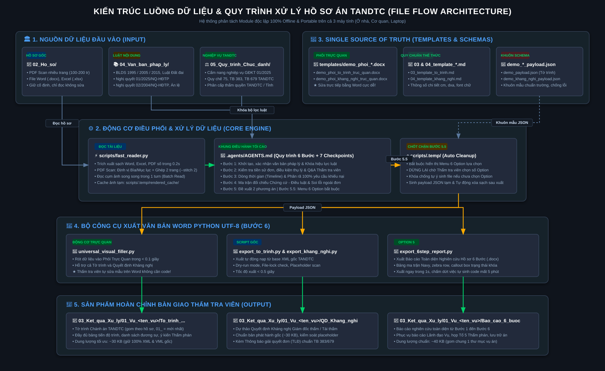
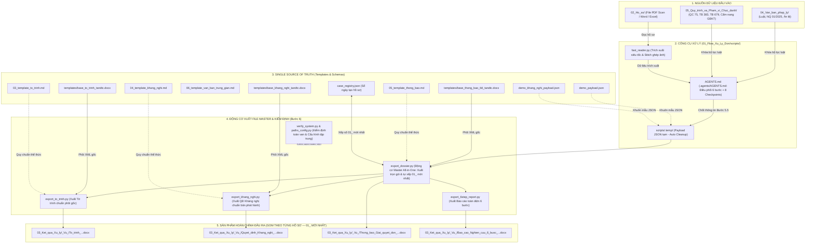

# KIẾN TRÚC LUỒNG DỮ LIỆU & QUY TRÌNH XỬ LÝ FILE (FILE FLOW ARCHITECTURE)

Tài liệu này mô tả chi tiết sơ đồ luồng dữ liệu, cách các file trong hệ thống liên kết với nhau từ lúc nạp hồ sơ gốc đến khi xuất bản văn bản Word hoàn chỉnh (.docx).

---

## 🏛️ Sơ Đồ Kiến Trúc Luồng Chạy File

---

## 📂 Chi Tiết 5 Phân Vùng Trong Luồng Xử Lý

1. **Phân vùng 1 - Đầu vào (`02_Ho_so/`, `04_Van_ban_phap_ly/`, `05_Quy_trinh_va_Pham_vi_Chuc_danh/`):**
   - Hồ sơ do người dùng nạp vào thư mục `02_Ho_so/`.
   - Hệ thống quét và khóa văn bản pháp lý áp dụng tại Bước 1.

2. **Phân vùng 2 - Động cơ xử lý (`scripts/fast_reader.py` & `.agents/AGENTS.md`):**
   - `fast_reader.py` đọc sạch nội dung văn bản text hoặc ghép đôi trang scan (`--stitch 2`) để đọc song song trong 1 turn.
   - `AGENTS.md` duy trì trạng thái cố định qua 6 bước (+ Cổng khóa 5.5) và 8 điểm dừng (Human Checkpoints).

3. **Phân vùng 3 - Khuôn mẫu chuẩn (`templates/`, `03/04/05/06_template_*.md`, `demo_*.json`, `case_registry.json`):**
   - **Cơ chế Phôi Mẫu Word Trực Quan (Visual Template):** Cho phép Thẩm tra viên mở trực tiếp các file Word mẫu bằng Microsoft Word để sửa phông chữ, kẻ lại bảng, đổi màu hoặc thêm bớt các mục bằng chuột 100%:
     + [demo_phoi_to_trinh_truc_quan.docx](templates/demo_phoi_to_trinh_truc_quan.docx) (Mẫu Tờ trình trực quan)
     + [demo_phoi_khang_nghi_truc_quan.docx](templates/demo_phoi_khang_nghi_truc_quan.docx) (Mẫu Kháng nghị trực quan)
     + [demo_phoi_thong_bao_truc_quan.docx](templates/demo_phoi_thong_bao_truc_quan.docx) (Mẫu Thông báo trả lời đơn trực quan)
   - `base_to_trinh_tandtc.docx`, `base_khang_nghi_tandtc.docx` và `base_thong_bao_tld_tandtc.docx` lưu giữ phôi XML gốc (đường kẻ VML, lề A4, footer).
   - `demo_payload.json` và `demo_khang_nghi_payload.json` định nghĩa chuẩn cấu trúc dữ liệu không được sai lệch; `case_registry.json` lưu mốc ngày tạo các hồ sơ để xếp thứ tự mới nhất lên đầu.

4. **Phân vùng 4 - Động cơ xuất hồ sơ Master, Cấu hình tập trung & Kiểm định (`scripts/`):**
   - `paths_config.py`: Điểm cấu hình đường dẫn tập trung duy nhất cho mọi script khi tái cấu trúc.
   - `verify_system.py`: Bộ kiểm định tự động toàn vẹn hệ thống (link, dung lượng `AGENTS.md`, phôi Word, placeholder ASCII, cú pháp Python, thứ tự ngày tạo).
   - `export_dossier.py`: Động cơ Master xuất trọn gói mọi loại văn bản (Tờ trình, Kháng nghị, Thông báo, Báo cáo 6 bước) trong < 0.5s chỉ với 1 lệnh CLI duy nhất và tự động xếp số `01_` cho hồ sơ mới nhất.
   - `universal_visual_filler.py`: Động cơ rót dữ liệu vào Phôi Mẫu Word Trực Quan trong < 0.2s.
   - `export_to_trinh.py`, `export_khang_nghi.py`, `export_6step_report.py`: Các công cụ xuất tự động theo phôi XML gốc.
   - Dữ liệu payload JSON tạm và cache ảnh render được lưu gọn trong `scripts/.temp/` và tự động dọn sạch.

5. **Phân vùng 5 - Đầu ra hoàn chỉnh (`03_Ket_qua_Xu_ly/`):**
   - Tất cả văn bản của cùng 01 hồ sơ vụ án được gom chung vào 01 thư mục con `03_Ket_qua_Xu_ly/<Số>_Vu_<ten_vu>/` *(số `01_` luôn là ngày tạo gần hiện tại nhất)* bao gồm: Tờ trình Chánh án TANDTC, Dự thảo Quyết định Kháng nghị GĐT/Tái thẩm, Thông báo giải quyết đơn (Trả lời đơn - TLĐ) và Báo cáo nghiên cứu 6 bước.
