# ⚖️ TUYỂN TẬP QUYẾT ĐỊNH GIÁM ĐỐC THẨM HỘI ĐỒNG THẨM PHÁN TANDTC (2016 – 2025)
> **Phân Vùng 04_03:** `04_Van_ban_phap_ly/04_03_Tuyen_tap_Giam_doc_tham_HDTP/`  
> *Kho Quyết định Giám đốc thẩm của Hội đồng Thẩm phán TANDTC – Nguồn tham khảo đường lối xét xử và căn cứ hủy/sửa án tối cao.*

---

## I. CẤU TRÚC KHO QUYẾT ĐỊNH GIÁM ĐỐC THẨM (PHÂN CẤP CHA - CON)

Kho tài liệu được tổ chức thành 2 chuyên ngành xét xử và 1 phân vùng lưu trữ gốc theo mã phân cấp:

```
04_03_Tuyen_tap_Giam_doc_tham_HDTP/
├── 04_03_01_Dan_su/                      <-- Cấp 2: Toàn bộ QĐ GĐT Dân sự từ 2016 đến 2025
│   ├── GĐT DS 2016 -> GĐT DS 2022
│   ├── Tuyển tập 91 QĐ GĐT Dân sự 2024 (Số 01 đến 91/2024/DS-GĐT)
│   └── Tuyển tập QĐ GĐT Dân sự 2025 (Số 01-15, 16, 17, 18, 19, 20, 22, 23, 25-38/2025)
│
└── 04_03_02_Kinh_doanh_Thuong_mai/       <-- Cấp 2: Tuyển tập QĐ GĐT KDTM từ 2016 đến 2025
    ├── GĐT KDTM 2016, 2018, 2019, 2020, 2021, 2022, 2023, 2024
    └── GĐT KDTM 2025 (Số 01 - 06/2025/KDTM-GĐT)
```

---

## II. DANH MỤC TUYỂN TẬP GIÁM ĐỐC THẨM DÂN SỰ (04_03_01_DAN_SU)
Thư mục lưu trữ: [`04_03_01_Dan_su/`](04_03_01_Dan_su/)

### 1. Trọn bộ 91 Quyết định Giám đốc thẩm Dân sự năm 2024
Năm 2024 là năm bản lề với 91 Quyết định Giám đốc thẩm được Hội đồng Thẩm phán TANDTC ban hành, thiết lập các chuẩn mực xét xử quan trọng:

| Đợt Xét Xử / Số Quyết Định | Ngày Ban Hành | Đặc Điểm Quan Trọng | File Gốc Liên Kết |
| :--- | :---: | :--- | :--- |
| **QĐ số 01 đến 55/2024/DS-GĐT** | Đầu năm 2024 | Tuyển tập 55 Quyết định GĐT đầu năm về tranh chấp đất đai, thừa kế, hợp đồng chuyển nhượng QSDĐ | [`GĐT DS 2024 01-55.pdf`](04_03_01_Dan_su/_Ban_goc/G%C4%90T%20DS%202024%2001-55.pdf) |
| **QĐ số 56 đến 66/2024/DS-GĐT** | 17/9 – 19/9/2024 | Đợt xét xử Giám đốc thẩm tháng 9/2024: tập trung tranh chấp ranh giới đất, hủy hợp đồng tặng cho, thừa kế có yếu tố nước ngoài | [`GĐT DS 56 ngày 17.09.2024.pdf`](04_03_01_Dan_su/_Ban_goc/G%C4%90T%20DS%2056%20ng%C3%A0y%2017.09.2024.pdf) đến [`GĐT DS 66 ngày 19.9.2024.pdf`](04_03_01_Dan_su/_Ban_goc/G%C4%90T%20DS%2066%20ng%C3%A0y%2019.9.2024.pdf) |
| **QĐ số 67 đến 84/2024/DS-GĐT** | 02/12 – 05/12/2024 | Đợt xét xử Giám đốc thẩm đầu tháng 12/2024: giải quyết tranh chấp hợp đồng đặt cọc mua bán nhà đất, hợp đồng vay tín dụng cá nhân, tài sản chung hộ gia đình | [`GĐT DS 67 ngày 2.12.2024.pdf`](04_03_01_Dan_su/_Ban_goc/G%C4%90T%20DS%2067%20ng%C3%A0y%202.12.2024.pdf) đến [`GĐT DS 84 ngày 5.12.2024.pdf`](04_03_01_Dan_su/_Ban_goc/G%C4%90T%20DS%2084%20ng%C3%A0y%205.12.2024.pdf) |
| **QĐ số 85 đến 91/2024/DS-GĐT** | 30/12 – 31/12/2024 | Đợt xét xử cuối năm 2024: xử lý các vụ án đặc biệt phức tạp về đất công chỉ, đòi đất mượn trước năm 1975, chia tài sản chung sau ly hôn | [`GĐT DS 85 ngày 30.12.2024.pdf`](04_03_01_Dan_su/_Ban_goc/G%C4%90T%20DS%2085%20ng%C3%A0y%2030.12.2024.pdf) đến [`GĐT DS 91 ngày 31.12.2024.pdf`](04_03_01_Dan_su/_Ban_goc/G%C4%90T%20DS%2091%20ng%C3%A0y%2031.12.2024.pdf) |
| **Bản Hợp nhất Số 56 đến 91** | Cuối năm 2024 | Toàn văn tuyển tập hợp nhất từ Quyết định số 56 đến 91/2024 | [`GĐT DS 56 - 91.pdf`](04_03_01_Dan_su/_Ban_goc/G%C4%90T%20DS%2056%20-%2091.pdf) |

### 2. Tuyển tập Quyết định Giám đốc thẩm Dân sự năm 2025 Mới Nhất
| Số Quyết Định | Nội Dung Trọng Tâm | File Gốc Liên Kết |
| :--- | :--- | :--- |
| **QĐ GĐT DS 2025: Số 01 đến 15** | Tuyển tập 15 Quyết định Giám đốc thẩm đầu tiên năm 2025 | [`GĐT DS 2025 01-15.pdf`](04_03_01_Dan_su/_Ban_goc/G%C4%90T%20DS%202025%2001-15.pdf) |
| **QĐ GĐT DS 2025: Số 16 đến 23** | Các Quyết định GĐT lẻ số 16, 17, 18, 19, 20, 22, 23 | [`GĐT DS 2025 16.pdf`](04_03_01_Dan_su/_Ban_goc/G%C4%90T%20DS%202025%2016.pdf) ... [`GĐT DS 2025 23.pdf`](04_03_01_Dan_su/_Ban_goc/G%C4%90T%20DS%202025%2023.pdf) |
| **QĐ GĐT DS 2025: Số 25 đến 38** | Các Quyết định GĐT số 25-27, 28, 29, 30, 31, 32, 33-35, 37-38 | [`GĐT DS 2025 25-27.pdf`](04_03_01_Dan_su/_Ban_goc/G%C4%90T%20DS%202025%2025-27.pdf) ... [`GĐT DS 2025 37-38.pdf`](04_03_01_Dan_su/_Ban_goc/G%C4%90T%20DS%202025%2037-38.pdf) |

### 3. Tuyển tập Giám đốc thẩm Dân sự các năm 2016 – 2022
* Tuyển tập hàng trăm Quyết định GĐT Dân sự qua các năm:
  * [`GĐT DS 2016.pdf`](04_03_01_Dan_su/_Ban_goc/G%C4%90T%20DS%202016.pdf)
  * [`GĐT DS 2017.pdf`](04_03_01_Dan_su/_Ban_goc/G%C4%90T%20DS%202017.pdf)
  * [`GĐT DS 2018.pdf`](04_03_01_Dan_su/_Ban_goc/G%C4%90T%20DS%202018.pdf)
  * [`GĐT DS 2019.pdf`](04_03_01_Dan_su/_Ban_goc/G%C4%90T%20DS%202019.pdf)
  * [`GDT DS 2020.pdf`](04_03_01_Dan_su/_Ban_goc/GDT%20DS%202020.pdf)
  * [`GĐT DS 2021.pdf`](04_03_01_Dan_su/_Ban_goc/G%C4%90T%20DS%202021.pdf)
  * [`GĐT DÂN SỰ 2022.pdf`](04_03_01_Dan_su/_Ban_goc/G%C4%90T%20D%C3%82N%20S%E1%BB%B0%202022.pdf)

---

## III. DANH MỤC TUYỂN TẬP GIÁM ĐỐC THẨM KINH DOANH THƯƠNG MẠI (04_03_02_KINH_DOANH_THUONG_MAI)
Thư mục lưu trữ: [`04_03_02_Kinh_doanh_Thuong_mai/`](04_03_02_Kinh_doanh_Thuong_mai/)

Kho tài liệu chuyên sâu về tranh chấp hợp đồng tín dụng ngân hàng, bảo lãnh thế chấp, mua bán hàng hóa, xây dựng, bảo hiểm và tranh chấp nội bộ công ty:

| Năm Ban Hành | Tên Tuyển Tập Quyết Định GĐT | Trọng Tâm Đường Lối KDTM | File Gốc Liên Kết |
| :---: | :--- | :--- | :--- |
| **2016** | Tuyển tập QĐ GĐT KDTM 2016 | Tranh chấp hợp đồng mua bán hàng hóa quốc tế, LC, bảo lãnh | [`GĐT KDTM 2016.pdf`](04_03_02_Kinh_doanh_Thuong_mai/_Ban_goc/G%C4%90T%20KDTM%202016.pdf) |
| **2018** | Tuyển tập QĐ GĐT KDTM 2018 | Xử lý tài sản bảo đảm, thế chấp cổ phần, thẩm quyền Trọng tài | [`GDT KDTM  2018.pdf`](04_03_02_Kinh_doanh_Thuong_mai/_Ban_goc/GDT%20KDTM%20%202018.pdf) |
| **2019** | Tuyển tập QĐ GĐT KDTM 2019 | Phạt vi phạm hợp đồng thương mại (giới hạn 8%), lãi suất nợ quá hạn | [`GĐT KDTM 2019.pdf`](04_03_02_Kinh_doanh_Thuong_mai/_Ban_goc/G%C4%90T%20KDTM%202019.pdf) |
| **2020** | Tuyển tập QĐ GĐT KDTM 2020 | Hiệu lực hợp đồng kinh doanh bảo hiểm, hợp đồng tổng thầu EPC | [`GDT KDTM 2020.pdf`](04_03_02_Kinh_doanh_Thuong_mai/_Ban_goc/GDT%20KDTM%202020.pdf) |
| **2021** | Tuyển tập QĐ GĐT KDTM 2021 | Tranh chấp thành viên công ty, tư cách người đại diện theo pháp luật | [`GDT KDTM 2021.pdf`](04_03_02_Kinh_doanh_Thuong_mai/_Ban_goc/GDT%20KDTM%202021.pdf) |
| **2022** | Tuyển tập QĐ GĐT KDTM 2022 | Vô hiệu hợp đồng thế chấp do tài sản hình thành trong tương lai chưa đủ điều kiện | [`GĐT KDTM 2022.pdf`](04_03_02_Kinh_doanh_Thuong_mai/_Ban_goc/G%C4%90T%20KDTM%202022.pdf) |
| **2023** | Tuyển tập QĐ GĐT KDTM 2023 | Tranh chấp phát hành trái phiếu doanh nghiệp, bảo lãnh thanh toán | [`GĐT KDTM 2023.pdf`](04_03_02_Kinh_doanh_Thuong_mai/_Ban_goc/G%C4%90T%20KDTM%202023.pdf) |
| **2024** | Tuyển tập QĐ GĐT KDTM 2024 | Toàn văn tuyển tập GĐT KDTM năm 2024 mới nhất | [`GĐT KDTM 2024.pdf`](04_03_02_Kinh_doanh_Thuong_mai/_Ban_goc/G%C4%90T%20KDTM%202024.pdf) |
| **2025** | QĐ GĐT KDTM Số 01 - 06/2025 | Tuyển tập các QĐ GĐT KDTM đầu năm 2025 | [`GĐT KDTM 01 -06.pdf`](04_03_02_Kinh_doanh_Thuong_mai/_Ban_goc/G%C4%90T%20KDTM%2001%20-06.pdf) |

---

## IV. BẢN ĐỒ CĂN CỨ HỦY ÁN THƯỜNG GẶP CỦA HỘI ĐỒNG THẨM PHÁN TANDTC

Qua tổng hợp từ tuyển tập các Quyết định Giám đốc thẩm, Hội đồng Thẩm phán TANDTC thường chấp nhận Kháng nghị và **HỦY BẢN ÁN SƠ THẨM / PHÚC THẨM** dựa trên 4 nhóm lỗi cốt tử sau:

```mermaid
graph TD
    HuyAn["CĂN CỨ HỦY BẢN ÁN CỦA HĐTP TANDTC"]
    
    L1["1. Thu thập chứng cứ chưa đầy đủ"]
    L2["2. Bỏ sót người tham gia tố tụng"]
    L3["3. Áp dụng sai phiên bản Luật nội dung"]
    L4["4. Tuyên án mâu thuẫn / Không thể thi hành"]
    
    HuyAn --> L1
    HuyAn --> L2
    HuyAn --> L3
    HuyAn --> L4
    
    L1 --> L1_1["Chưa xem xét thẩm định tại chỗ / đo đạc hiện trạng đất tranh chấp"]
    L1 --> L1_2["Chưa xác minh nguồn gốc đất và lịch sử biến động qua các thời kỳ"]
    L1 --> L1_3["Chưa định giá tài sản hoặc bỏ sót tài sản gắn liền trên đất"]
    
    L2 --> L2_1["Bỏ sót thành viên hộ gia đình tại thời điểm cấp GCN QSDĐ"]
    L2 --> L2_2["Bỏ sót đồng thừa kế hoặc người đang trực tiếp quản lý di sản"]
    L2 --> L2_3["Bỏ sót người thứ ba nhận chuyển nhượng ngay tình"]
    
    L3 --> L3_1["Áp dụng BLDS 2015 cho hợp đồng xác lập thời kỳ Pháp lệnh 1991"]
    L3 --> L3_2["Áp dụng Luật Đất đai 2013 cho giao dịch năm 1998"]
    L3 --> L3_3["Tính sai trần lãi suất hoặc tính lãi trên nợ lãi"]
    
    L4 --> L4_1["Tuyên giao đất nhưng không có sơ đồ kích thước tứ cận"]
    L4 --> L4_2["Nhận định hợp đồng vô hiệu nhưng quyết định lại công nhận"]
    L4 --> L4_3["Tuyên buộc thi hành hành vi cơ quan nhà nước không thể làm"]
```



---

## V. CÁCH THỨC DẪN CHIẾU ÁN TƯƠNG TỰ TẠI BƯỚC 4 & BƯỚC 5

Khi lập Tờ trình và dự thảo Quyết định Kháng nghị Giám đốc thẩm, Thẩm tra viên trích dẫn đối chiếu theo cấu trúc chuẩn:

> *"Đường lối giải quyết vụ án của Tòa án cấp sơ thẩm (hoặc phúc thẩm) là chưa phù hợp với thực tiễn xét xử và đường lối của Hội đồng Thẩm phán TANDTC. Cụ thể, tại **Quyết định Giám đốc thẩm số [Số]/2024/DS-GĐT ngày [Ngày] của Hội đồng Thẩm phán TANDTC** trong một vụ án có tình tiết tương tự (về việc tranh chấp hợp đồng chuyển nhượng QSDĐ mà diện tích thực tế thừa so với GCN), Hội đồng Thẩm phán đã nhận định: '[Trích dẫn 1-2 câu nhận định cốt lõi của HĐTP]'. Do đó, việc Tòa án cấp dưới tuyên [nêu phán quyết sai] là không có căn cứ, cần phải kháng nghị hủy bản án để xét xử lại theo đúng đường lối."*
