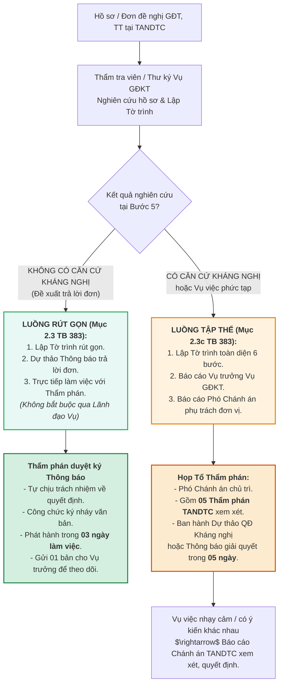

# QUY TRÌNH NỘI BỘ GIẢI QUYẾT ĐƠN ĐỀ NGHỊ GIÁM ĐỐC THẨM, TÁI THẨM TẠI TANDTC
## (TỔNG HỢP THEO QUY CHẾ 75/QĐ-CA, THÔNG BÁO 383/TB-TANDTC VÀ THÔNG BÁO 679/TB-TANDTC NĂM 2026)

---

> **MỤC TIÊU & TẦM QUAN TRỌNG:**
> Đây là cẩm nang pháp lý và quy chuẩn vận hành nội bộ chuẩn xác nhất tại TANDTC trong năm 2026, phản ánh đúng cơ chế làm việc thực tế hàng ngày của Thẩm tra viên và Thư ký viên các Vụ Giám đốc kiểm tra (Vụ GĐKT I, II, III, IV).
> 
> Hệ thống quy định này gồm 3 văn bản cốt lõi:
> 1. **Quy chế số 75/QĐ-CA** ngày 06/4/2026 của Chánh án TANDTC Nguyễn Văn Quảng: Khung quy chế tổng thể về quy trình giải quyết đơn GĐT/TT.
> 2. **Thông báo số 383/TB-TANDTC** ngày 22/6/2026 của Chánh án TANDTC Nguyễn Văn Quảng: **Cải cách đột phá rút gọn quy trình**, giảm tải tầng nấc duyệt để đẩy nhanh tiến độ giải quyết đơn.
> 3. **Thông báo số 679/TB-TANDTC** ngày 03/11/2026 của Phó Chánh án TANDTC Nguyễn Văn Tiến: **Chỉ đạo tiếp tục áp dụng toàn diện quy trình rút gọn theo Thông báo 383** cho tới khi có văn bản mới.

---

## PHẦN I: SƠ ĐỒ 2 LUỒNG GIẢI QUYẾT ĐƠN THEO CƠ CHẾ RÚT GỌN (TB 383 & TB 679)

---

## PHẦN II: CHI TIẾT 2 LUỒNG NGHIỆP VỤ & TRÁCH NHIỆM CHỨC DANH

### LUỒNG 1: ĐỀ XUẤT TRẢ LỜI ĐƠN — "QUY TRÌNH RÚT GỌN ĐẶC BIỆT" (MỤC 2.3 TB 383)
Đây là cải cách then chốt nhất giúp Thẩm tra viên, Thư ký giải quyết nhanh số lượng lớn các đơn khiếu nại không có căn cứ mà không bị nghẽn ở khâu ký duyệt:

1. **Trách nhiệm của Công chức nghiên cứu (Thẩm tra viên / Thư ký):**
   - Lập **Tờ trình rút gọn**: Tập trung phân tích ngắn gọn, sắc bén các lý do đương sự khiếu nại và chỉ rõ căn cứ bản án cấp dưới đã giải quyết đúng pháp luật.
   - **Bắt buộc dự thảo sẵn Thông báo giải quyết đơn** đính kèm theo Tờ trình.
   - **Ký nháy văn bản:** 
     + Công chức nghiên cứu chịu trách nhiệm ký nháy vào văn bản trả lời của Thẩm phán TAND bậc 3.
     + Công chức giúp việc của Thẩm phán TANDTC chịu trách nhiệm ký nháy vào văn bản trả lời của Thẩm phán TANDTC.
2. **Trách nhiệm của Thẩm phán (`Thẩm phán TANDTC` / `Thẩm phán TAND bậc 3`):**
   - Nghiên cứu trực tiếp hồ sơ cùng công chức nghiên cứu **mà KHÔNG BẮT BUỘC phải có sự tham gia của Lãnh đạo Vụ**.
   - Thẩm phán phải có quan điểm giải quyết rõ ràng, cụ thể.
   - **Duyệt ký Thông báo giải quyết đơn và tự chịu trách nhiệm về quyết định của mình**.
3. **Thời hạn phát hành & Lưu trữ:**
   - Trong thời hạn **03 ngày làm việc** kể từ ngày Thẩm phán ký duyệt, công chức phải phát hành Thông báo giải quyết đơn.
   - Đồng thời gửi **01 bản tới Vụ trưởng Vụ Giám đốc kiểm tra** để theo dõi, tổng hợp quản lý.

---

### LUỒNG 2: ĐỀ XUẤT CÓ CĂN CỨ KHÁNG NGHỊ HOẶC VỤ ÁN PHỨC TẠP
Áp dụng đối với các vụ việc phát hiện sai lầm nghiêm trọng của Tòa cấp dưới cần kháng nghị, hoặc vụ án có vướng mắc phức tạp về đánh giá chứng cứ:

1. **Thẩm tra viên / Thư ký:**
   - Soạn thảo **Tờ trình toàn diện 6 bước** đầy đủ bút lục, đối chiếu chứng cứ và ma trận phân tích điều luật.
   - Soạn sẵn **Dự thảo Quyết định Kháng nghị** theo đúng phôi phát hành gốc của TANDTC.
2. **Lãnh đạo Vụ Giám đốc kiểm tra (Vụ trưởng / Phó Vụ trưởng):**
   - Tổng hợp, cho ý kiến chỉ đạo nghiệp vụ và báo cáo Phó Chánh án TANDTC phụ trách khối.
3. **Phiên họp Tổ 05 Thẩm phán (Phó Chánh án chủ trì):**
   - Phó Chánh án phụ trách (với tư cách Tổ trưởng Tổ Thẩm phán) quyết định tổ chức và chủ trì phiên họp gồm **05 Thẩm phán TANDTC** để thảo luận tập thể.
   - **Thời hạn chốt:** Trong thời hạn **05 ngày làm việc** kể từ khi kết thúc phiên họp, phải ban hành Thông báo giải quyết hoặc hoàn thiện Dự thảo Quyết định Kháng nghị.
   - Nếu có nhiều ý kiến không thống nhất hoặc vụ án nhạy cảm, phức tạp $\rightarrow$ Báo cáo Chánh án TANDTC xem xét, quyết định.

---

## PHẦN III: PHẠM VI THẨM QUYỀN CÁC CẤP CHỨC DANH THEO QUY CHẾ 75

| Cấp Chức danh | Thẩm quyền & Trách nhiệm chính trong công tác Đơn GĐT/TT |
| :--- | :--- |
| **Chánh án TANDTC** | - Quyết định kháng nghị hoặc không kháng nghị các vụ án lớn, phức tạp, nhạy cảm chính trị/xã hội. - Phân công giải quyết án; ủy quyền cho Phó Chánh án phân công Thẩm phán. - Kháng nghị bản án của TAND cấp huyện/khu vực khi xét thấy cần thiết *(Khoản 3 Điều 2 NQ 01)*. |
| **Phó Chánh án TANDTC** *(phụ trách lĩnh vực)* | - Phụ trách chỉ đạo, đôn đốc toàn diện công tác giải quyết đơn của khối. - Làm Tổ trưởng Tổ Thẩm phán, chủ trì họp Tổ 05 Thẩm phán giải quyết án phức tạp/đề xuất kháng nghị. - Duyệt ký Quyết định kháng nghị, Thông báo giải quyết theo ủy quyền của Chánh án. - Ký quyết định tạm đình chỉ hoặc hoãn thi hành án khi có căn cứ. |
| **Thẩm phán TANDTC & Thẩm phán TAND bậc 3** | - Trực tiếp nghiên cứu hồ sơ cùng công chức Vụ GĐKT. - **Ký duyệt Thông báo trả lời đơn** đối với các vụ việc không có căn cứ kháng nghị (theo TB 383 & 679). - Tham gia phiên họp Tổ Thẩm phán, biểu quyết đường lối xử lý vụ án. - Chịu trách nhiệm cá nhân về quan điểm và quyết định ký duyệt của mình. |
| **Vụ trưởng Vụ GĐKT** | - Quản lý, điều phối tổng thể tiến độ giải quyết đơn của Vụ. - Rà soát, xác định các vụ việc cần rút hồ sơ hoặc có đủ điều kiện giải quyết không cần rút hồ sơ. - Báo cáo Phó Chánh án tổ chức họp Tổ Thẩm phán đối với án phức tạp/đề xuất kháng nghị. - Nhận 01 bản Thông báo giải quyết rút gọn của Thẩm phán để theo dõi số liệu. |
| **Thẩm tra viên / Thư ký Vụ GĐKT** | - Tiếp nhận hồ sơ, nghiên cứu chuyên sâu, phát hiện sai sót của bản án cấp dưới. - Soạn Tờ trình (rút gọn hoặc toàn diện) và Dự thảo văn bản (Thông báo trả lời đơn hoặc QĐ Kháng nghị). - Ký nháy vào văn bản trả lời theo phân công. - Hoàn tất phát hành văn bản trong thời hạn 03 ngày làm việc sau khi Thẩm phán ký. |

---

## PHẦN IV: CẬP NHẬT TRỰC TIẾP VÀO WORKFLOW 6 BƯỚC CỦA HỆ THỐNG AI

Từ nay, hệ thống AI sẽ tự động điều chỉnh hành vi tại các bước theo đúng **Thông báo 383 & 679**:

1. **Tại Bước 5 (Đề xuất ý kiến):**
   - Nếu chốt **"Hướng B: Trả lời đơn không có căn cứ kháng nghị"**:
     $\rightarrow$ AI tự động chuyển sang chế độ **"Tờ trình rút gọn"** và chuẩn bị sẵn cấu trúc **Dự thảo Thông báo trả lời đơn cho Thẩm phán duyệt ký trực tiếp** (loại bỏ yêu cầu duyệt Lãnh đạo Vụ để tiết kiệm thời gian cho Thẩm tra viên).
   - Nếu chốt **"Hướng A: Kháng nghị giám đốc thẩm / Tái thẩm"**:
     $\rightarrow$ AI tự động chuyển sang chế độ **"Tờ trình toàn diện"** (đầy đủ bút lục, đối chiếu điều luật, rà soát vi phạm ngoài đơn) phục vụ cho phiên họp **Tổ 05 Thẩm phán** của Phó Chánh án.

2. **Tại Bước 5.5 & 6 (Xuất văn bản):**
   - Khi chọn xuất **Tờ trình**: Nếu là Hướng B, xuất Tờ trình rút gọn kèm Thông báo trả lời đơn.
   - Nếu là Hướng A, xuất Tờ trình toàn diện + Dự thảo Quyết định Kháng nghị.
   - Luôn ghi đúng chức danh ký nháy và ký duyệt: `THẨM PHÁN TANDTC` hoặc `THẨM PHÁN TAND BẬC 3`.
